# Mosbius & Co.

**Your coding story starts here.** A desktop app that runs the coding agents already on your machine as a crew, inside a pixel-art world inspired by *How I Met Your Mother*.

*A fan-made project, not affiliated with, endorsed by or connected to the show, its makers or its owners. See [Licence and credits](#licence-and-credits).*

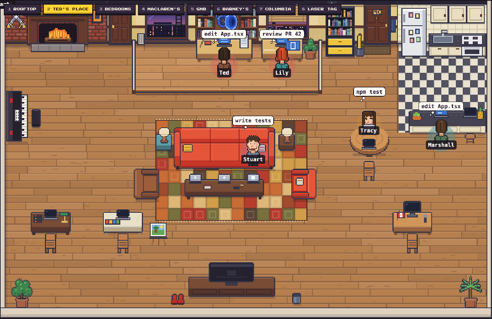

Open a workspace, add agents, and watch them work. Each agent is a real command-line coding agent in its own terminal, signed in with the account you already have. Mosbius & Co. adds what a pile of terminal windows lacks: one place to see every agent, a crew with a boss on every floor, shared tasks and memory, and a controlled way to give each agent access to outside tools.

> **New in v1.1.0: the Agent Huddle.** Your AI team doesn't need a babysitter. A small window keeps every agent within reach, and notifications you can answer tell you when to step in. [See the Huddle](#agent-huddle). For macOS on Apple silicon and Windows.

**Contents:** [Features](#features) · [Seven locations](#the-seven-locations) · [Agent Huddle](#agent-huddle) · [Coding agents](#coding-agents) · [Integrations](#integrations-and-the-mcp-ecosystem) · [Skills](#skills) · [Access and permissions](#agent-access-and-permissions) · [Downloads](#installation-and-downloads) · [Quick start](#quick-start) · [Previews](#feature-previews) · [Technology](#technology) · [Documentation](#documentation) · [Licence](#licence-and-credits)

## Features

- **A crew, not a pile of windows.** Many agents at once, each in its own terminal with its own folder, history and memory. Mix Claude Code, Codex and Gemini CLI in the same office.
- **Work alone or together.** Use one agent and ignore the rest, or let a boss hand out tasks and agents pass work to each other.
- **A command centre.** For the selected agent: terminal, monitor, tasks, an "ask me" queue, triggers, memory, a graph, activity, skills and hired workers.
- **Agent Huddle and notifications.** Step away from the main window and keep a small, always-on-top Huddle beside your work: every agent as a character, what it is doing and who needs you. Desktop notifications tell you when a task finishes or an agent needs a decision, and you can approve, reject or answer from there, or open an agent's conversation and terminal. A finished task rings a bright piano hook, every other kind of event has its own short, warm, original tune, and Settings lets you hear every one and set the volume.
- **A world worth looking at.** Painted pixel-art rooms where characters sit down to work, wander off and take a break at the booth in MacLaren's.
- **Plug in your tools.** Connect services such as GitHub, Notion, Linear, Slack and Google Workspace, and decide exactly which agent may use what.
- **Skills.** Browse a catalogue of agent skills and install the ones you want.
- **Local first.** Your workspace stays on your machine, and there is no Mosbius & Co. account to create.

## The seven locations

Each location is its own workspace with its own boss and team. Press **1** to **7**, or use the tabs above the floor.

| Key | Location | Boss |
|---|---|---|
| 1 | The rooftop | Robin |
| 2 | Ted's apartment | Ted |
| 3 | MacLaren's Pub | Carl |
| 4 | Goliath National Bank (GNB) | Arthur |
| 5 | Barney's apartment | Barney |
| 6 | Columbia University | Ted |
| 7 | Laser tag | Barney |

<table>
  <tr>
    <td width="33%" valign="top"> <b>MacLaren's, from the street</b> Go down the steps to walk in.</td>
    <td width="33%" valign="top"> <b>MacLaren's Pub</b> The booth, the bar, the jukebox and the pool table.</td>
    <td width="33%" valign="top">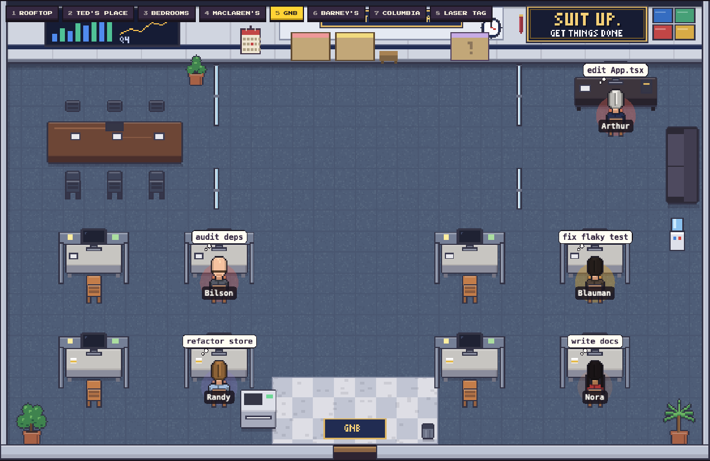 <b>GNB</b> Desks, monitors and the task boards.</td>
  </tr>
  <tr>
    <td width="33%" valign="top">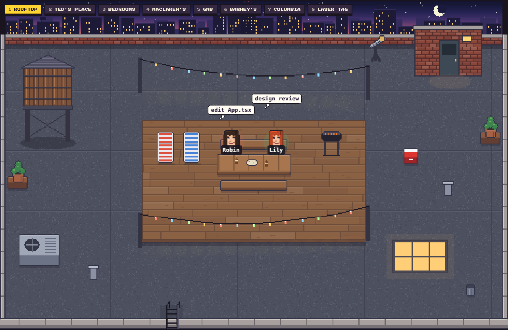 <b>The rooftop</b> String lights, the water tower and the skyline.</td>
    <td width="33%" valign="top">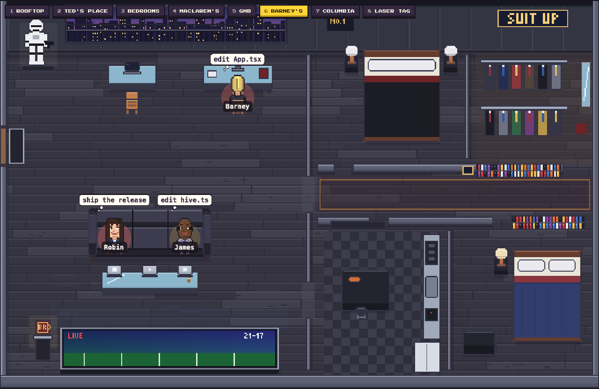 <b>Barney's place</b> The suit room, the big screen, the Bro Code.</td>
    <td width="33%" valign="top"> <b>Columbia</b> Architecture 101, with a big chalkboard.</td>
  </tr>
  <tr>
    <td width="33%" valign="top"> <b>Laser tag</b> Neon barriers and two bases.</td>
  </tr>
</table>

## Agent Huddle

- **Your Agents, Always Within Reach.** Huddle Mode.
- **Step In Only When It Matters.** Intelligent Notifications.
- **Unified Agent Control.** Switch between agents, inspect conversations, access terminals, send instructions, and manage tasks from a single compact interface. Your entire AI team stays coordinated and accessible from anywhere on your desktop.

> New in v1.1.0, for macOS on Apple silicon and Windows (64-bit).

<a href="screenshots/huddle/huddle-desktop.mp4">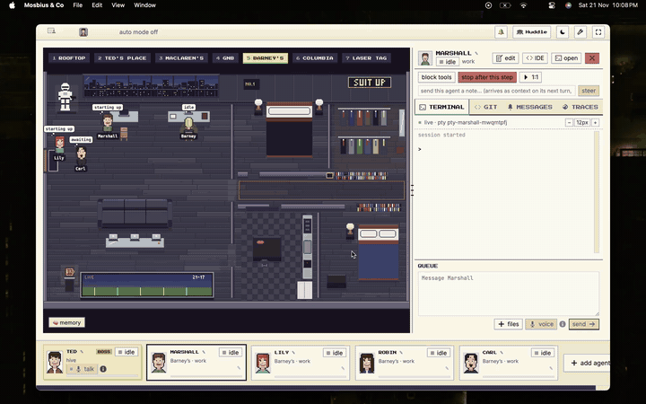</a> <a href="screenshots/huddle/huddle-desktop.mp4">▶ Watch the full video</a> (no sound): it goes on to open the Huddle out, with its notifications, an agent's conversation and its terminal

<table>
  <tr>
    <td width="50%" valign="top">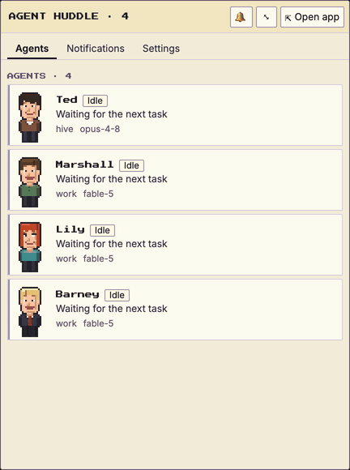 <b>Approve from the Huddle</b></td>
    <td width="50%" valign="top">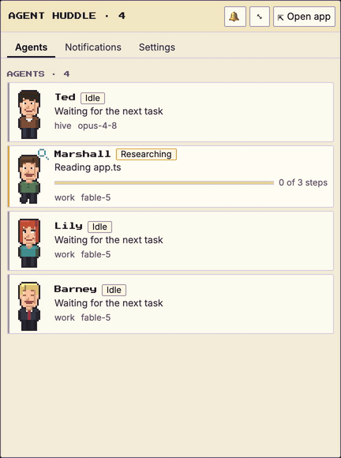 <b>Answer a question</b></td>
  </tr>
</table>

<a href="screenshots/huddle/huddle-story.mp4">▶ Watch the close-up as one video</a> (no sound)

<table>
  <tr>
    <td width="33%" valign="top">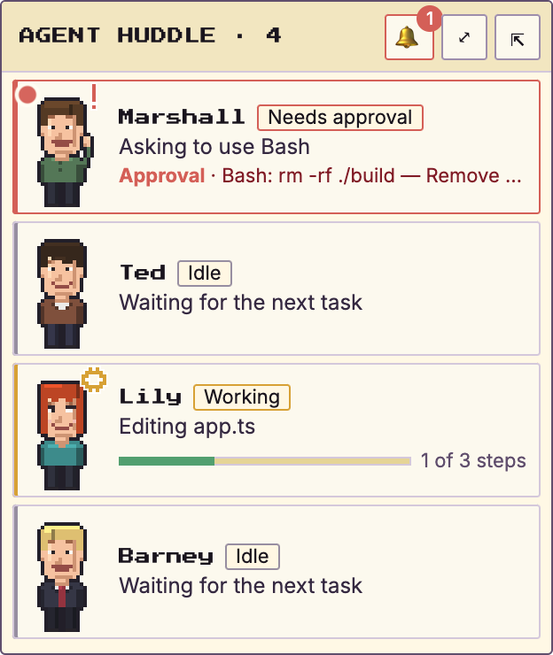 <b>Compact</b></td>
    <td width="33%" valign="top">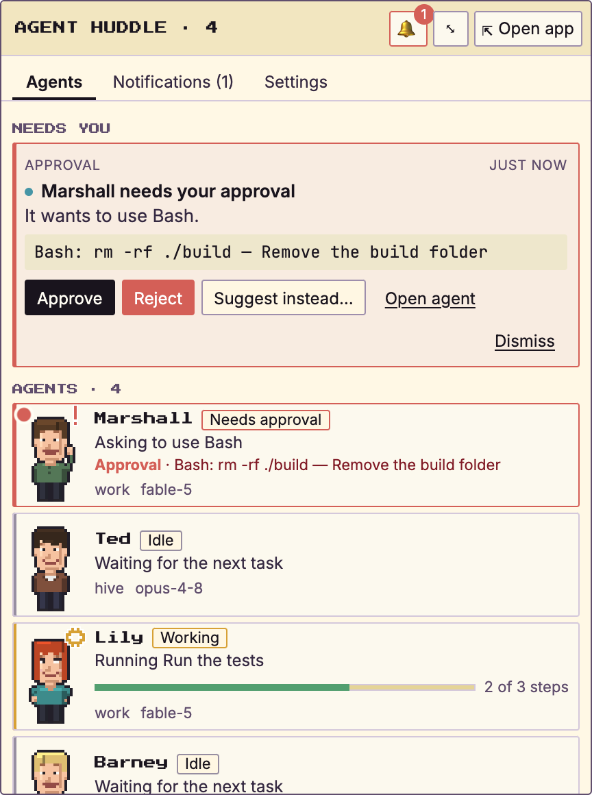 <b>Expanded</b></td>
    <td width="33%" valign="top"> <b>One agent</b></td>
  </tr>
</table>

## Coding agents

Mosbius & Co. works with the coding agents already installed on your computer, each signed in through its own official login. **You only need one.**

| Agent | With Mosbius & Co. |
|---|---|
| **Claude Code** | Runs in its own terminal and reaches your integrations and skills through the app. |
| **OpenAI Codex** | Runs in its own terminal and reaches your integrations and skills through the app. |
| **Google Gemini CLI** | Runs in its own terminal and reaches your integrations and skills through the app. |

The app finds them for you under **Settings → Coding agents**, shows whether each is signed in, and can install or update one after you approve the exact command. It never asks for your password.

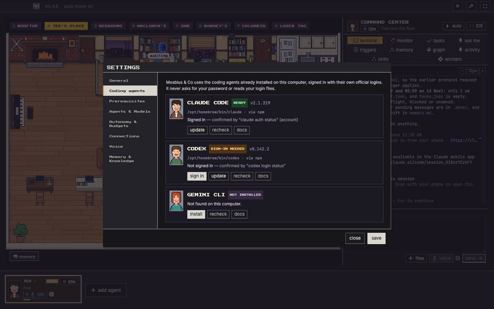

## Integrations and the MCP ecosystem

**Settings → Integrations & Skills** is a catalogue of what your agents can reach: local tools that run on your computer and hosted services you sign in to.

| Category | Includes |
|---|---|
| Local tools | Sequential Thinking, Time, Fetch, Filesystem, Git, Context7 docs, Browser |
| Developer tools | GitHub, Sentry |
| Productivity and knowledge | Notion, Linear, Jira, Confluence |
| Communication | Slack |
| Google Workspace | Gmail, Google Calendar, Google Drive |
| Search and research | Brave Search |
| Business and payments | Stripe, HubSpot |
| Custom APIs | Any REST API of your own, with its own key |

Everything is off until you switch it on. You connect a service by signing in on its own page or by pasting a key you created; keys are stored encrypted by your operating system.

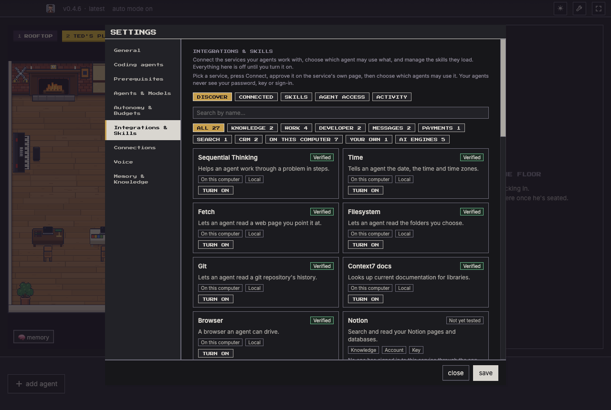

How each service connects is described in [INTEGRATIONS.md](INTEGRATIONS.md).

## Skills

A skill is a folder of instructions an agent can load. The Skills tab lets you browse a community catalogue, see where each skill comes from, install it for Claude Code or for Codex and Gemini CLI, check that it is unchanged, preview every line of an update before it is applied, and roll back. Installing a skill never connects a service and never grants permission. See [SKILLS.md](SKILLS.md).

## Agent access and permissions

You stay in control of what every agent can do.

1. **Switch a service on.** Nothing is on by default.
2. **Connect it** on the service's own page, or with a key you create. Agents never see your password or key.
3. **Give an agent access**: none, read, write, or a hand-picked list of tools, with an optional end time.

Sending, posting and deleting are never included by "read" or "write"; you tick them by name. Taking access away applies immediately, and the Activity tab records what was done and whether it was allowed. Details are in [INTEGRATIONS.md](INTEGRATIONS.md) and [SECURITY_REPORT.md](SECURITY_REPORT.md).

## Installation and downloads

**[⬇ Download for macOS (Apple silicon)](https://github.com/rajguruyash/Mosbius-Co/releases/tag/v1.1.0)** &nbsp;·&nbsp; **[⬇ Download for Windows (64-bit)](https://github.com/rajguruyash/Mosbius-Co/releases/tag/v1.1.0.0)** &nbsp;·&nbsp; [All releases](https://github.com/rajguruyash/Mosbius-Co/releases)

Version 1.1.0, the Huddle release, is for **macOS on Apple silicon** and **Windows (64-bit)**. Intel Macs and Linux are not part of this release. Each button opens that release's page on GitHub, where the installer is. Earlier releases stay on the [releases page](https://github.com/rajguruyash/Mosbius-Co/releases); they do not have the Huddle.

| Platform | Package | Release |
|---|---|---|
| macOS | `.dmg`, Apple Silicon | [v1.1.0](https://github.com/rajguruyash/Mosbius-Co/releases/tag/v1.1.0) |
| Windows | `.exe` installer, 64-bit | [v1.1.0.0](https://github.com/rajguruyash/Mosbius-Co/releases/tag/v1.1.0.0) |

You need at least one coding agent installed and signed in. On macOS, open the `.dmg`, drag the app into Applications, and the first time right-click it and choose **Open**. On Windows, run the installer; if Windows asks you to confirm because it does not know the app yet, choose **More info**, then **Run anyway**. The Windows installer is new and has not been tried on a real Windows computer yet, so please [open an issue](https://github.com/rajguruyash/Mosbius-Co/issues) if something does not work. Running from source, requirements and troubleshooting are in [DEVELOPMENT.md](DEVELOPMENT.md).

## Quick start

1. Open the app and choose a workspace folder.
2. Pick the coding agent your boss should use.
3. Add agents with **+ add agent**. They join the location you are looking at.
4. Switch locations with the tabs above the floor, or keys 1 to 7.
5. Optional: open **Settings → Integrations & Skills** to connect a service and give an agent access.

## Feature previews

<table>
  <tr>
    <td width="50%" valign="top">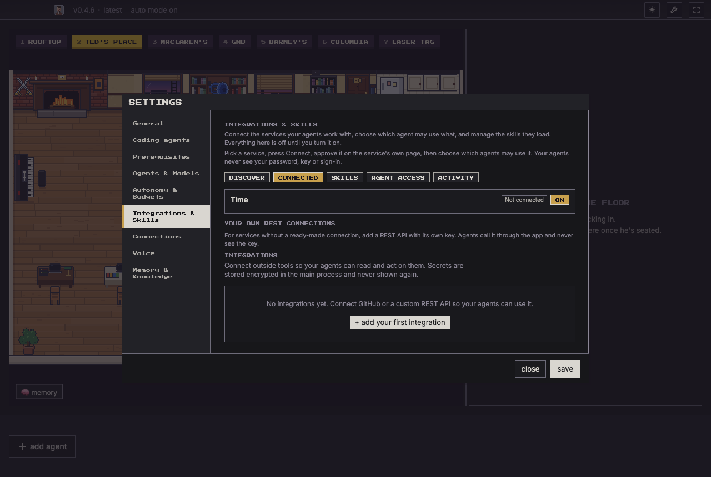 <b>Connected</b> Switch services on and off and choose which tools may be used.</td>
    <td width="50%" valign="top"> <b>Skills</b> Install, check, update and roll back skills.</td>
  </tr>
  <tr>
    <td width="50%" valign="top"> <b>Activity</b> A record of what each agent did and whether it was allowed.</td>
    <td width="50%" valign="top"> <b>The crew</b> Your coding team, one character each.</td>
  </tr>
</table>

## Technology

Electron, React and Pixi.js, with each agent in a real pseudo-terminal (`node-pty`). The pixel-art world is painted by code in `tools/himym/`. Architecture and development notes are in [DEVELOPMENT.md](DEVELOPMENT.md).

## Documentation

| Document | What |
|---|---|
| [INTEGRATIONS.md](INTEGRATIONS.md) | Providers, how each connects, who can use what |
| [SKILLS.md](SKILLS.md) | Skills in detail |
| [SECURITY_REPORT.md](SECURITY_REPORT.md) | Security findings and known limitations |
| [MCP_BROKER_DESIGN.md](MCP_BROKER_DESIGN.md) | How the access broker works |
| [DEVELOPMENT.md](DEVELOPMENT.md) | Running from source, CI, project layout, verification and status |
| [MOSBIUS_PLATFORM_ROADMAP.md](MOSBIUS_PLATFORM_ROADMAP.md) | Engineering progress and remaining work |
| [CHANGELOG.md](CHANGELOG.md) | What changed |

## Licence and credits

MIT; see `LICENSE`. The pixel art in `src/renderer/src/assets/himym/` is original to this project. Bundled fonts keep their own licence (`src/renderer/src/assets/fonts/LICENSE.txt`). See `src/renderer/src/assets/ATTRIBUTION.md`.

Mosbius & Co. is a fan-made project inspired by How I Met Your Mother. It is not affiliated with, endorsed by or connected to the show, its makers or its owners.

Built upon the original Munder Difflin project; credit to its original creators for the foundational work.
