# Mosbius & Co.

A desktop app that runs a crew of coding agents on your own machine, inside a pixel-art world inspired by How I Met Your Mother. Each agent is a real command-line coding agent in its own terminal; each location is its own workspace with its own boss and team.

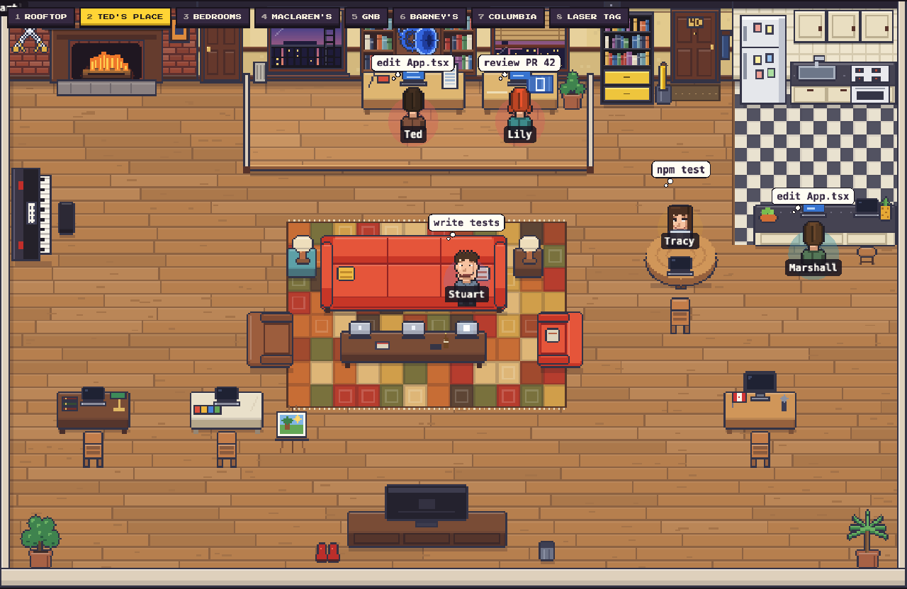

## Download Mosbius & Co.

| Platform | Package | Status |
|---|---|---|
| **macOS** (Apple Silicon) | `.dmg` | Built and tested; the first release is not published yet. It will appear on the [Releases page](https://github.com/rajguruyash/Mosbius-Co/releases). Until then, [build it yourself](#development). |
| **Windows** | `.exe` installer | Coming soon |
| **Linux** | AppImage / `.deb` | Coming soon |

Windows and Linux downloads will be added once those builds have been tested. Mac builds are for Apple Silicon (M1 and later) only.

### Installing

- **macOS:** open the `.dmg` and drag **Mosbius & Co** into Applications. The app is not yet signed with an Apple Developer ID, so the first time, right-click it in Applications and choose **Open**.
- **Windows** (when available): run the installer and follow the steps. Windows SmartScreen may warn about an unsigned app; choose **More info → Run anyway**.
- **Linux** (when available): make the AppImage executable (`chmod +x Mosbius-Co-*.AppImage`) and run it, or install the `.deb` with `sudo apt install ./Mosbius-Co-*.deb`.

## What it does

- **Many coding agents, one place.** Detected automatically (see below). Claude Code, Codex, Gemini CLI, Cursor, Copilot CLI, Grok, Qwen, Kimi Code, OpenCode, Crush, Pi and Antigravity, or any custom command. Each runs as its own process with its own terminal, using the subscriptions and logins you already have.
- **Several locations, separate teams.** An agent belongs to the location that was open when you added it, and only that location shows it. Agents keep running whichever location you are looking at.
- **A boss per location.** Ted at his apartment and at Columbia, Barney at his apartment and at laser tag, Robin on the rooftop, Carl at MacLaren's, Arthur at GNB.
- **A command centre.** Terminal, tasks, triggers, memory, activity and an "ask me" queue for the selected agent, whatever location it is in.
- **Agents that move.** They sit down to work, walk between locations through the doors, take breaks in the booth at MacLaren's and say the odd line.

## Bring your own coding agents

Mosbius & Co works with the coding agents already installed on your computer, each signed in through its own official login. **You only need one.** Any single signed-in agent runs the whole crew; the rest are optional and can be added later.

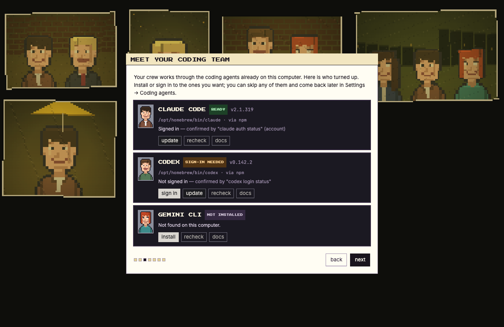

- **Found automatically.** On first launch, and any time in **Settings → Coding agents**, the app looks for Claude Code, Codex and Gemini CLI and shows the version, where each is installed and whether it is signed in.
- **Sign-in checked honestly.** Claude Code and Codex are asked through their own status commands, so "signed in" is confirmed. Gemini CLI has no status command, so it is only ever shown as *probably* signed in.
- **Nothing happens without you.** Install and Update show the exact command and run only after you approve it. Sign in opens the agent's own login in a Terminal window. Mosbius never asks for your password, never reads login files, and does not need an API key for an agent you have already signed in to.
- **Optional providers.** Codex and Gemini CLI are marked optional. Each card says what signing in needs; plans and free allowances are set by each provider, so the app points to them rather than promising limits.
- **Mix and match.** Agents from different providers can work at the same time, in the same location or in different ones, each in its own terminal.

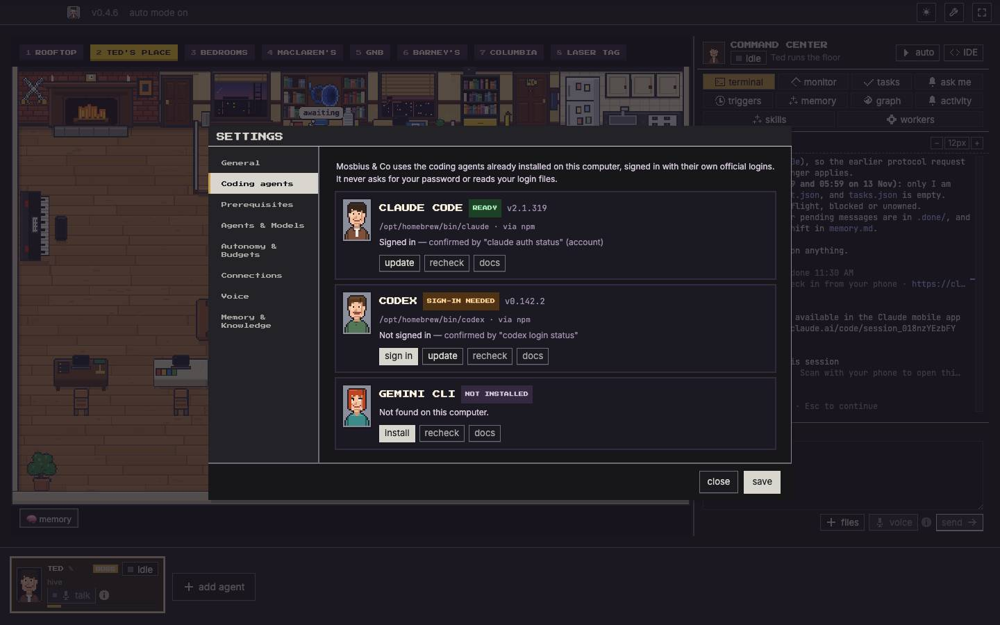

## The locations

| | |
|---|---|
| 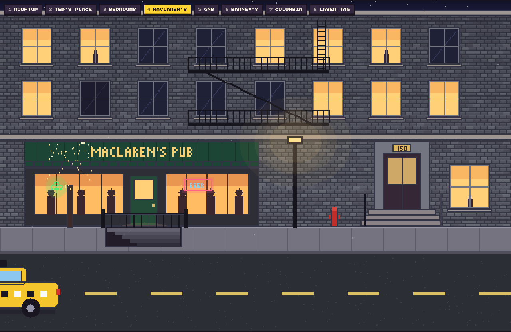 The street: click the door to walk in | 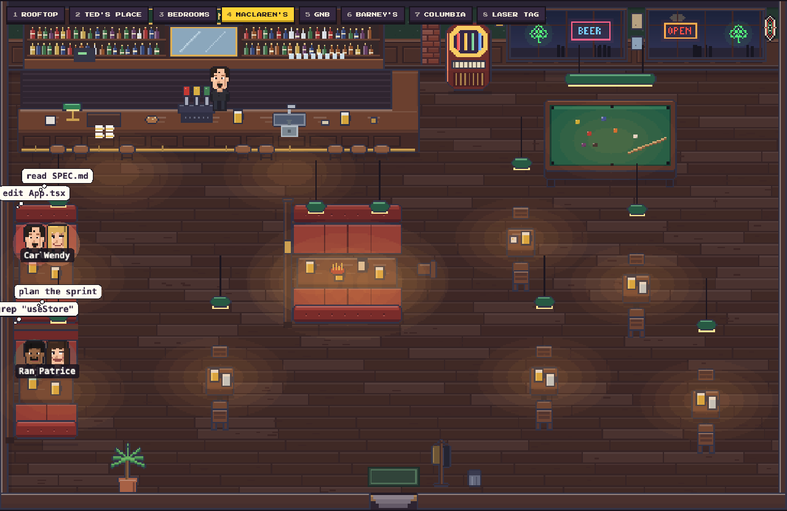 MacLaren's Pub |
| 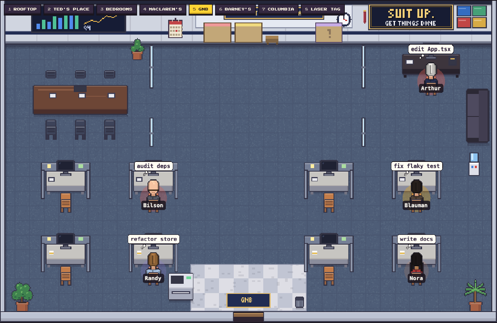 Goliath National Bank: the task boards live here | 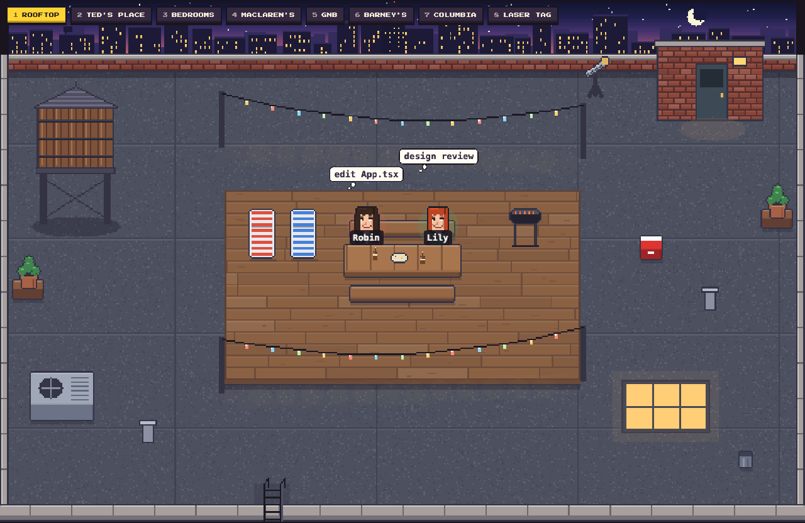 The rooftop |
| 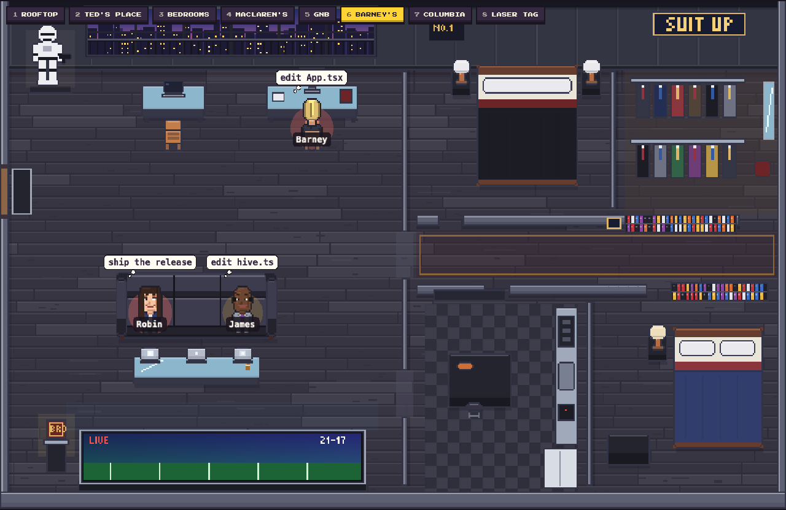 Barney's apartment | 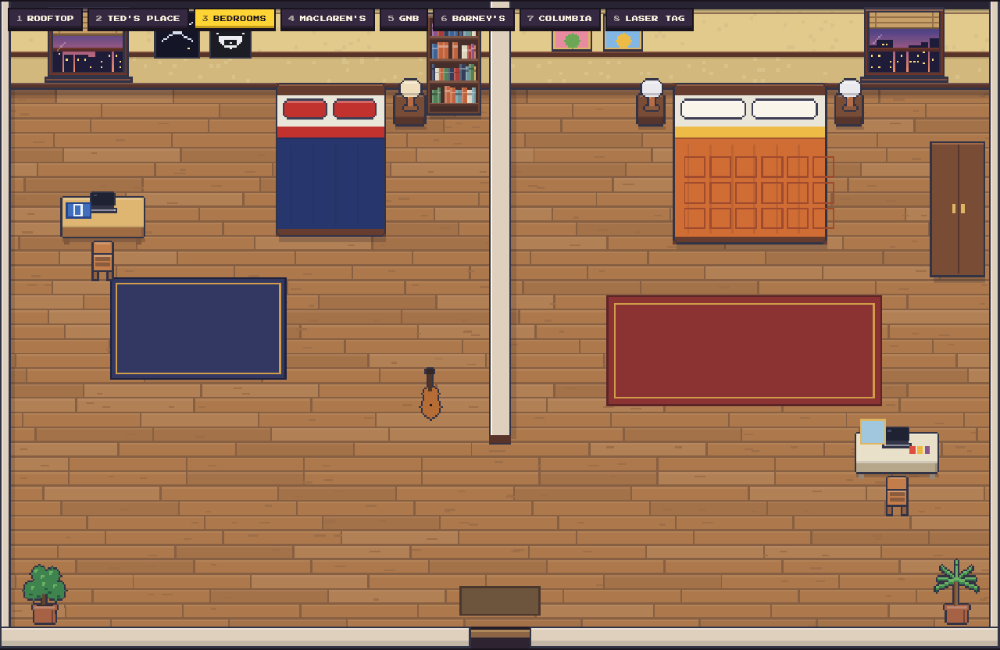 The bedrooms |
| 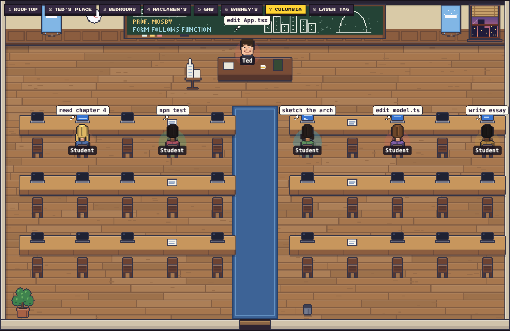 Columbia: Architecture 101 | 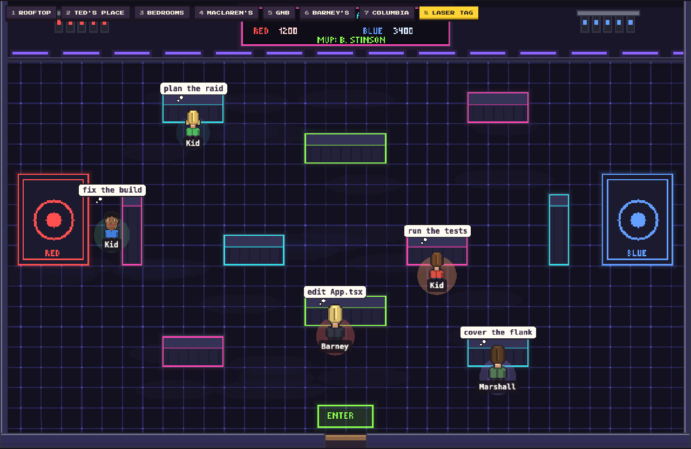 Laser tag |

## Run from source

You need Node 22.

```bash
git clone https://github.com/rajguruyash/Mosbius-Co.git
cd Mosbius-Co
npm install
npm run dev
```

Each agent needs its own command-line tool installed and signed in (for example `claude`, `codex`, `gemini`). The app can install the ones that are missing.

## First run

1. Choose a workspace: a folder where the app keeps one crew's agents, memory, tasks and settings. Opening or creating a workspace never changes another one.
2. Pick the coding agent the boss should use.
3. Add agents with **+ add agent**. They join the location you are looking at.
4. Switch locations with the tabs above the floor, or keys 1 to 8.

## How it is built

- **Electron** main process: spawns each agent in a pseudo-terminal (`node-pty`), routes messages between agents through a local folder of plain files, keeps tasks and memory.
- **React** renderer: the command centre, agent cards, settings.
- **Pixi.js** floor: one painted world image with depth-sorted pieces, tile collision, door links between locations, characters drawn from per-character recipes.
- **The art is generated by code.** `tools/himym/` paints every room and exports the images and map data the app loads: `python3 tools/himym/build.py`.

Where things are:

| Path | What |
|---|---|
| `src/main/` | agent processes, message routing, tasks, config |
| `src/renderer/src/scene/office/` | the floor: world, camera, characters, cast |
| `src/renderer/src/components/` | command centre, cards, setup screens |
| `tools/himym/` | the room painters and exporter |

## Development

```bash
npm run dev            # run the app from source
npm run typecheck      # type checks
npm run test:focused   # tests
npm run dist:mac       # build a Mac app and DMG into dist/
```

`npx vite --config vite.lab.config.ts` serves only the floor, with stand-in agents, at `http://localhost:5199/lab.html`.

## Licence and credits

MIT; see `LICENSE`. The pixel art in `src/renderer/src/assets/himym/` is original to this project. Bundled fonts keep their own licence (`src/renderer/src/assets/fonts/LICENSE.txt`). See `src/renderer/src/assets/ATTRIBUTION.md`.

Mosbius & Co. is a fan-made project inspired by How I Met Your Mother. It is not affiliated with, endorsed by or connected to the show, its makers or its owners.

Built upon the original Munder Difflin project; credit to its original creators for the foundational work.
