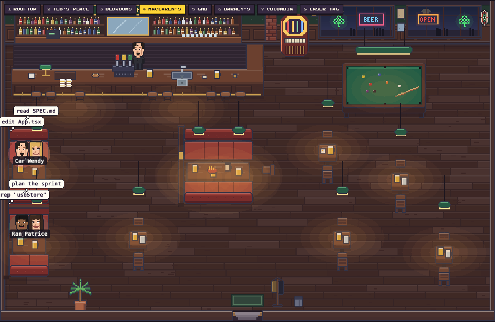
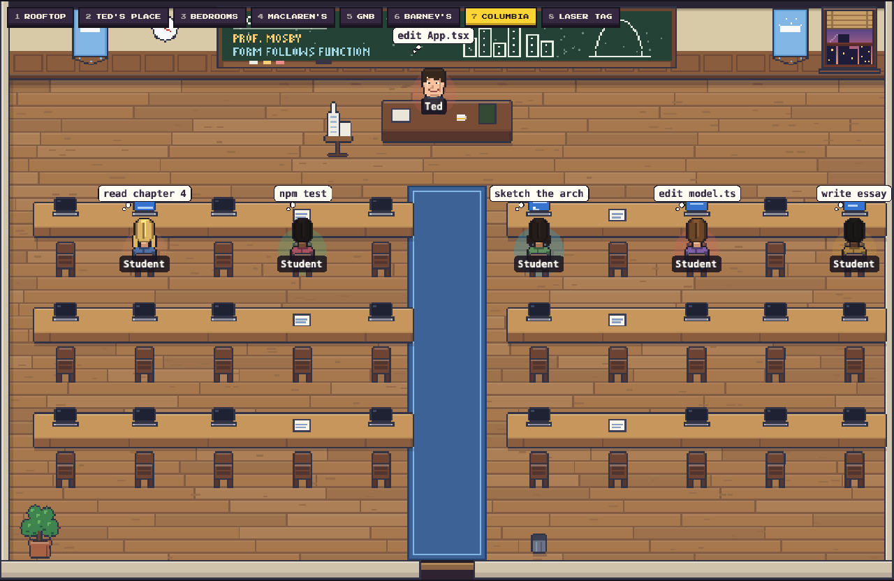
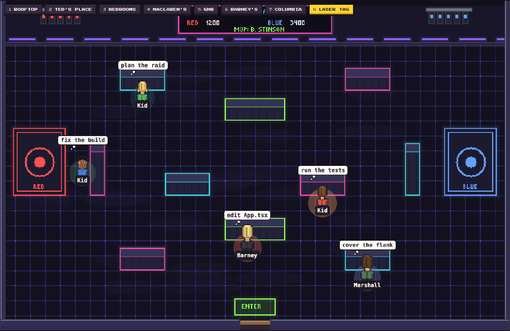
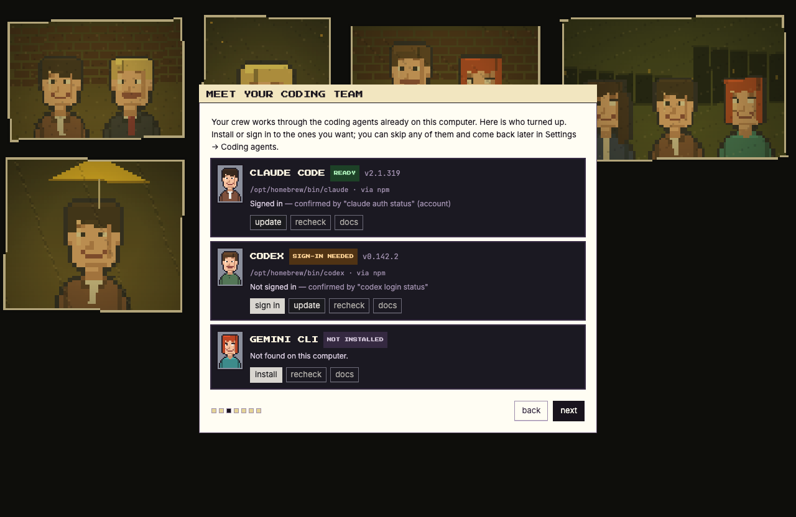
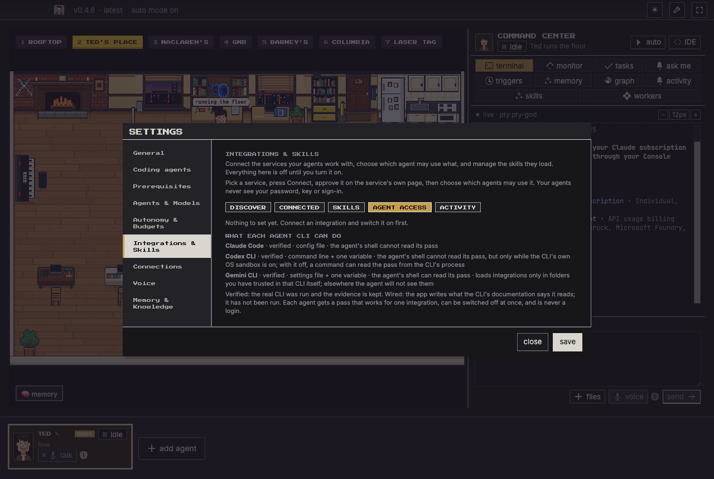
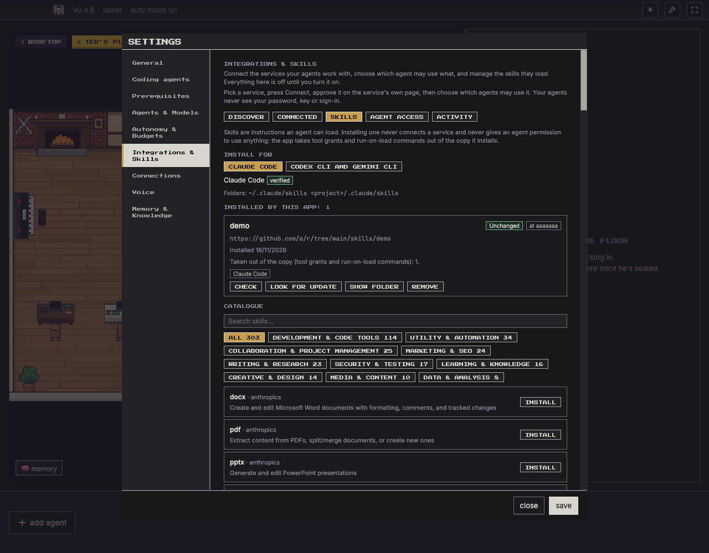
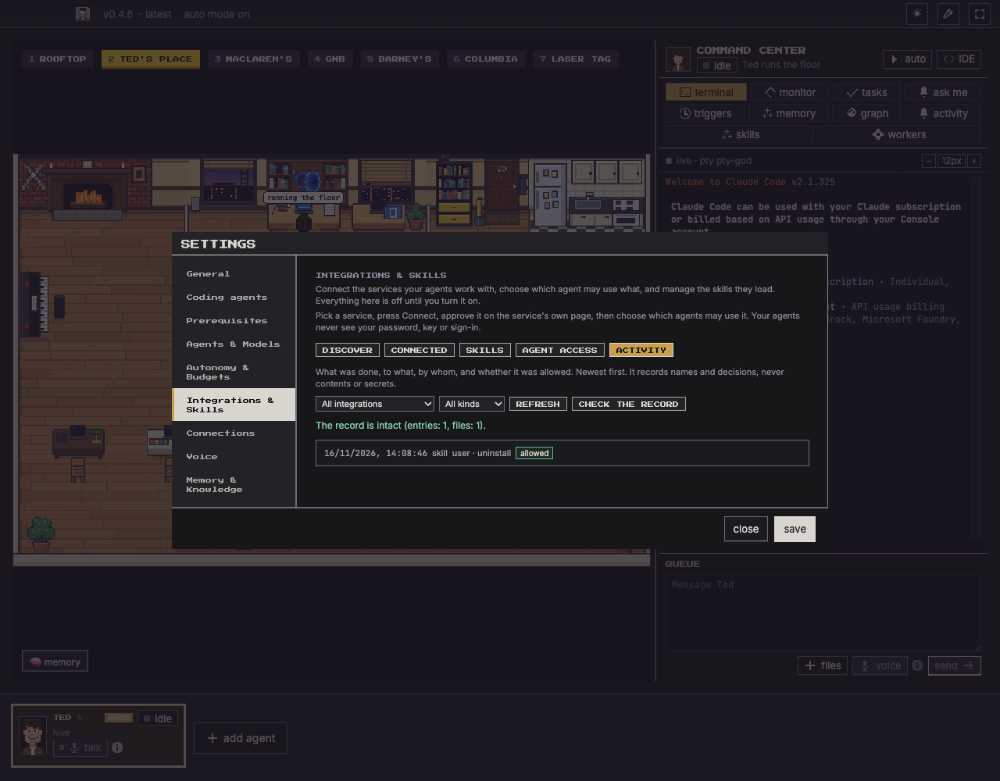

# Mosbius & Co.

A desktop app that runs a crew of coding agents on your own machine, inside a pixel-art world inspired by *How I Met Your Mother*. Each agent is a real command-line coding agent in its own terminal; each of the seven locations is its own workspace with its own boss and team.

*A fan-made project, not affiliated with, endorsed by or connected to the show, its makers or its owners. See [Licence and credits](#licence-and-credits).*


> **Read this first: what this page describes.** It describes the `main` branch of this repository. The published installers ([v1.0.0](https://github.com/rajguruyash/Mosbius-Co/releases/tag/v1.0.0) for macOS and [v1.0.0.0](https://github.com/rajguruyash/Mosbius-Co/releases/tag/v1.0.0.0) for Windows) were built **before** the Integrations & Skills platform, the in-app broker and the Codex and Gemini integrations existed, so they do not contain them. To use what is described below, [run from source](#run-from-source) (or [build an installer yourself](#development)) until a newer release is published. Nothing here has been verified with a real third-party account: see [Project status](#project-status) for exactly what has and has not been checked.

**Contents:** [Download](#download-mosbius--co) · [What it is](#what-mosbius--co-is) · [The seven locations](#the-seven-locations) · [Coding agents](#coding-agents) · [Integrations & Skills](#integrations--skills) · [The integration catalogue](#the-integration-catalogue) · [Skills](#skills) · [Security and known limitations](#security-and-known-limitations) · [Installation and setup](#installation-and-setup) · [Troubleshooting](#troubleshooting) · [Project status](#project-status) · [Continuous integration](#continuous-integration) · [How it is built](#how-it-is-built) · [Development](#development) · [Licence and credits](#licence-and-credits)

## Download Mosbius & Co.

**[⬇ Download for macOS](https://github.com/rajguruyash/Mosbius-Co/releases/download/v1.0.0/Mosbius-Co-1.0.0-mac-arm64.dmg)** &nbsp;·&nbsp; **[⬇ Download for Windows](https://github.com/rajguruyash/Mosbius-Co/releases/download/v1.0.0.0/Mosbius-Co-1.0.0.0-win-x64-setup.exe)**

| Platform | Package | Release | Notes |
|---|---|---|---|
| **macOS** | `.dmg` (Apple Silicon, ARM64) | [v1.0.0](https://github.com/rajguruyash/Mosbius-Co/releases/tag/v1.0.0) | Optimised for Apple Silicon (M1 and later). Tested on a Mac. |
| **Windows** | `.exe` installer (64-bit) | [v1.0.0.0](https://github.com/rajguruyash/Mosbius-Co/releases/tag/v1.0.0.0) | Windows 10/11 (x64). Initial release; community testing welcome. **Built on a Mac and not yet tested on real Windows hardware.** |
| **Linux** | AppImage | — | In development. An AppImage target is configured, but it has never been built or run. |

### Installing

- **macOS:** open the `.dmg` and drag **Mosbius & Co** into Applications. The app is not yet signed with an Apple Developer ID, so the first time, right-click it in Applications and choose **Open**.
- **Windows:** run the installer and follow the steps. Windows SmartScreen may warn about an unsigned app; choose **More info → Run anyway**.
- **Linux** (when available): make the AppImage executable (`chmod +x Mosbius-Co-*.AppImage`) and run it.
- **Note:** macOS and Windows installers are currently unsigned, so your operating system may display a security prompt during installation.

## What Mosbius & Co. is

Mosbius & Co. is a command centre dressed as a TV office. You open a workspace folder and add agents; each agent is a real coding-agent command line running in its own terminal on your machine, signed in with the logins and subscriptions you already have. The app adds what a pile of terminal windows lacks: one place to see every agent, a crew structure, tasks and memory, ways for agents to hand work to each other and, in the current `main` branch, a controlled way to give each agent access to outside tools.

- **Many agents, one place.** Each agent runs as its own process in its own pseudo-terminal, with its own working directory, history and memory. Agents from different providers can run at the same time, in the same location or in different ones.
- **Independent or collaborating.** You can use agents one by one and ignore the rest. When you want a team, the app routes messages between agents through a local folder of plain files (the *hive*), keeps a shared task ledger, and gives every location a boss agent that runs its floor.
- **A command centre.** For the selected agent, wherever it is: terminal, monitor, tasks, an "ask me" queue, triggers, memory, a graph, activity, skills and hired workers.
- **A world to look at.** The office is painted by code (`tools/himym/`) and drawn with Pixi.js: depth-sorted furniture, tile collision, characters that sit down to work, walk about and take breaks at the booth in MacLaren's.

### The seven locations

Each location is its own workspace with its own boss and team. Press **1** to **7**, or use the tabs above the floor.

| Key | Location | Boss |
|---|---|---|
| 1 | The rooftop | Robin |
| 2 | Ted's apartment | Ted |
| 3 | MacLaren's Pub | Carl |
| 4 | Goliath National Bank (GNB) | Arthur |
| 5 | Barney's apartment | Barney |
| 6 | Columbia University | Ted |
| 7 | Laser tag | Barney |

<table>
  <tr>
    <td width="33%" valign="top">
      <br>
      <b>Ted's place</b><br>
      <sub>The main workspace: red couch, fireplace, the fire-escape window.</sub>
    </td>
    <td width="33%" valign="top">
      <br>
      <b>MacLaren's, from the street</b><br>
      <sub>Click the door to walk in.</sub>
    </td>
  </tr>
  <tr>
    <td width="33%" valign="top">
      <br>
      <b>MacLaren's Pub</b><br>
      <sub>The booth, the bar, the jukebox and the pool table.</sub>
    </td>
    <td width="33%" valign="top">
      <br>
      <b>GNB</b><br>
      <sub>Goliath National Bank: the task boards live here.</sub>
    </td>
    <td width="33%" valign="top">
      <br>
      <b>The rooftop</b><br>
      <sub>String lights, the water tower and the skyline.</sub>
    </td>
  </tr>
  <tr>
    <td width="33%" valign="top">
      <br>
      <b>Barney's place</b><br>
      <sub>Suit room, the big screen, the Bro Code.</sub>
    </td>
    <td width="33%" valign="top">
      <br>
      <b>Columbia</b><br>
      <sub>Architecture 101, with a big chalkboard.</sub>
    </td>
    <td width="33%" valign="top">
      <br>
      <b>Laser tag</b><br>
      <sub>Neon barriers and two bases.</sub>
    </td>
  </tr>
</table>

**How locations work, and what does not move.** An agent belongs to the location that was open when you added it, and only that location's floor shows it. Changing location changes which crew you are looking at: a curtain crosses the floor (stairs between the rooftop, the apartment and the pub, a cab ride to anywhere else), and the pub is entered from the street. **It never touches a session:** every agent's terminal, tasks and memory keep running whichever location you are looking at. **There is no control yet to move an existing agent from one location to another**; the roster is fixed when an agent is added, so that is not implemented.

## Coding agents

Mosbius & Co. works with the coding agents already installed on your computer, each signed in through its own official login. **You only need one.** Any single signed-in agent runs the whole crew; the rest are optional and can be added later.



- **Found automatically.** On first launch, and any time in **Settings → Coding agents**, the app looks for Claude Code, Codex and Gemini CLI and shows the version, where each is installed and whether it is signed in.
- **Sign-in checked honestly.** Claude Code and Codex are asked through their own status commands (`claude auth status`, `codex login status`), so "signed in" is confirmed. Gemini CLI has no status command, so it is only ever shown as *probably* signed in.
- **Nothing happens without you.** Install and Update show the exact command and run only after you approve it. Sign in opens the agent's own login in a Terminal window. Mosbius never asks for your password, never reads login files, and does not need an API key for an agent you have already signed in to.
- **Mix and match.** Agents from different providers can work at the same time, each in its own terminal.


### What was checked for each of the three

The **Integrations & Skills** platform below is built for three agent CLIs. Each is handed its access in its own way, because the three programs do not read the same configuration. The table says what was actually run, with what, and what is known to be weaker.

<!-- gen:agents:start (generated by tools/gen-docs.cjs from src/shared/agentCompat.ts and the evidence files; do not edit by hand) -->

| Coding agent | Version run | How it is handed an integration | Can its shell read the pass? | Integrations | Skills |
| --- | --- | --- | --- | --- | --- |
| **Claude Code** | 2.1.325 | Gets its integrations from a config file in its own folder that its own settings forbid it to read. Skills live in its own folder. | No | Verified: the real CLI, 26 of 26 checks passed (2026-11-15), with a real model (haiku) and the real pinned local servers; no third-party account | Verified: the real CLI lists skills from `~/.claude/skills`, `<project>/.claude/skills` |
| **Codex CLI** | 0.142.2 | Gets the broker address on its command line and the pass in one variable that is kept out of its shell's environment. Skills live in the shared agents folder. | No, **only while Codex's OS sandbox is on**; with it off, a command can read it from the Codex process | Verified: the real CLI, 39 of 39 checks passed (2026-11-16), with a stand-in model and a stand-in provider; no model account and no third-party account | Verified: the real CLI lists skills from `~/.agents/skills`, `<project>/.agents/skills`, `<project>/.codex/skills` |
| **Gemini CLI** | 0.68.0 | Gets a Gemini home of its own whose settings name one variable that holds the pass. Skills live in the shared agents folder. Loads integrations only in folders you have trusted in Gemini. | **Yes** (finding F9, left open: no Gemini setting can stop it) | Verified: the real CLI, 50 of 50 checks passed (2026-11-16), with a stand-in model and a stand-in provider; no model account and no third-party account | Verified: the real CLI lists skills from `~/.agents/skills`, `~/.gemini/skills`, `<project>/.agents/skills`, `<project>/.gemini/skills` |

<!-- gen:agents:end -->

Only the versions in the table were run, and these programs change quickly: on 2026-11-16 the npm registry already had a newer Codex CLI (0.169.0) than the one that was run (0.142.2), and nothing here says a newer release behaves the same way.

"Verified" here means *the real command-line program was run against the real broker and the real app, and the run is recorded in the repository*. It does **not** mean a real third-party account was used. Claude Code was run with a real model and the real pinned local servers; Codex and Gemini were run with a stand-in model and a stand-in provider, so whether a real OpenAI or Gemini model uses the offered tools well was not tested, and no Gemini login was used (whether a real Gemini login carries into an agent's home is untested). Details and the exact limits are in [INTEGRATIONS.md](INTEGRATIONS.md) and [SECURITY_REPORT.md](SECURITY_REPORT.md).

### Install and sign in

| Agent | Install | Sign in | Docs |
|---|---|---|---|
| **Claude Code** | `npm install -g @anthropic-ai/claude-code` | `claude auth login` | [docs.claude.com](https://docs.claude.com/en/docs/claude-code) |
| **Codex CLI** | `npm install -g @openai/codex` | `codex login` | [github.com/openai/codex](https://github.com/openai/codex) |
| **Gemini CLI** | `npm install -g @google/gemini-cli` | run `gemini` and sign in with Google (or set `GEMINI_API_KEY`) | [github.com/google-gemini/gemini-cli](https://github.com/google-gemini/gemini-cli) |

The app can run these install commands for you from **Settings → Coding agents**, after you approve the exact command. Plans, free allowances and limits are set by each provider; the app points to them rather than promising any.

### Other agents the app can start

Besides the three above, the app can start Cursor, Copilot, Grok, Qwen, Kimi Code, OpenCode, Crush, Pi and Antigravity, or any custom command. **The Integrations & Skills platform does not cover them**: only Claude Code, Codex and Gemini CLI are handed integrations or have skills managed by the app.

## Integrations & Skills

All of it lives in **Settings → Integrations & Skills**. The rule behind it:

> **Nothing is on, connected, installed or reachable by an agent until you turn it on, and an agent gets nothing until you give that agent access.** Switching a service on only makes it available; each agent then needs access of its own, per agent and per tool, and the starting point is none.

<table>
  <tr>
    <td width="50%" valign="top">
      <br>
      <b>Discover</b><br>
      <sub>Every service, how it connects and how far it has been checked.</sub>
    </td>
    <td width="50%" valign="top">
      <br>
      <b>Agent access</b><br>
      <sub>Who may use what, and what each coding agent can and cannot do.</sub>
    </td>
  </tr>
  <tr>
    <td width="50%" valign="top">
      <br>
      <b>Skills</b><br>
      <sub>Installed skills with their source and commit. (The "demo" skill in this capture was installed by the test harness from a stand-in repository.)</sub>
    </td>
    <td width="50%" valign="top">
      <br>
      <b>Activity</b><br>
      <sub>The tamper-evident record of what was done and whether it was allowed.</sub>
    </td>
  </tr>
</table>

These are real captures of the packaged app, taken by [`tools/ui-validate.cjs`](tools/ui-validate.cjs) on a throwaway profile; no account is connected in any of them.

### The five tabs

| Tab | What it does |
|---|---|
| **Discover** | Lists every service and how it connects, with a plain label on each card. Search, filter by kind, press Connect. |
| **Connected** | What is connected: switch it on or off, set which tools each may use, **Disconnect**. |
| **Skills** | Browse a catalogue, install for the agent CLI of your choice, check, update with a preview, roll back, remove. |
| **Agent access** | One table of who may use what: per agent, per tool, none by default. Also what each CLI can do, and its caveats. |
| **Activity** | What was done, to what, by whom and whether it was allowed. A hash-chained record you can verify. |

The interface is in English, Simplified Chinese and Arabic (right to left).

### How a service connects

The app tries the ways a service offers, in this order:

1. **Sign in with your account** (Notion, Linear, Sentry, Stripe, Atlassian). The app registers itself with the service for that one sign-in (RFC 7591), opens the service's own page in your browser, and you approve. PKCE protects the exchange and the redirect goes to a random port on `127.0.0.1`. Nothing of the app's own is kept: no secret, no registration beyond the sign-in.
2. **A sign-in code** (GitHub). You type a short code at GitHub's page (RFC 8628). It needs a GitHub App whose client ID you provide; the client ID is a public value.
3. **An OAuth app you register** (Gmail, Google Calendar, Google Drive, Slack). These services do not let an app register itself, so you register an app of your own, store its client ID and secret, and sign in once.
4. **A key you create** (Brave Search, HubSpot, the Notion token, a REST API of your own). Stored encrypted by your operating system and never shown again.
5. **Nothing to connect.** The local servers run on this computer.

**Local MCP servers** are installed by the app from a version-pinned, hash-checked lock into its own folder, with install scripts switched off, and are run by the app, not by the agent. **Hosted MCP providers** are reached over their own sign-in. **REST integrations** are nine templates (GitHub, Linear, Jira, Confluence, Notion, Stripe, Sentry, HubSpot, and any base URL of your own); the key is attached by the loopback broker at the moment of the call, so the agent never holds it.

### Who may do what

- **Deny by default.** A new agent can reach nothing. An integration reaches an agent only when you have (1) switched it on, (2) connected it or stored its credential, and (3) granted that agent access.
- **Per agent, per tool.** Access is *read*, *write*, or a hand-picked list of tools, with an optional end time. Every tool is classed **read**, **write** or **destructive** from a list the project pinned; a tool nobody classified is treated as destructive. A tool that sends, posts or deletes is never included by *read* or *write*: you tick it by name. For REST, `GET`, `HEAD` and `OPTIONS` are read, `POST`, `PUT` and `PATCH` are write, `DELETE` and any unknown method are destructive, and a GraphQL request counts as read only if its document is a query.
- **An agent gets a pass, not your login.** What an agent holds is a random value that belongs to that one agent and that one integration, that the app can cancel at any moment, and that works only against the app's own loopback address. The broker checks the pass and the grant on every request, before anything reaches a service, and records the decision.
- **Immediate revocation.** Switching a service off, disconnecting it, or taking an agent's access away applies to that agent's next request and cancels the ones in flight. It cannot undo what a service has already done. Revoking while an agent is mid-run was tested through the real Codex and Gemini CLIs.
- **When access reaches a running agent.** Narrowing, or widening an integration the agent already has, applies on its next request. An agent that started with *no* access to an integration does not get it mid-session (a CLI does not pick up a new server while running): start a new session for that agent.
- **Disconnect and reconnect.** Disconnect asks the service to revoke the sign-in (RFC 7009) where it offers that, then deletes what the app holds; reconnecting is a new sign-in. For the legacy bridge, tokens are sealed back and deleted when the last agent that uses them ends, when the app quits, and at the next start after a crash.
- **Activity and audit.** Every decision is appended to a hash-chained record (names and decisions, never contents or secrets) whose newest end is sealed separately, so a deleted, truncated, rolled-back or edited log is detected. **Check the record** in the Activity tab verifies it.

### Where the secrets are

A key is read from the operating system's encrypted store and handed to the one local server it belongs to over a private pipe, so it is in no argument, no environment variable, no file and no log. Sign-in tokens and configuration secrets (the Slack signing secret and bot token, the Groq key, the org key, webhook secrets) live in that store too. The page you see (the renderer) is given statuses and names only, never a credential. On Linux without a keyring, the app refuses to store credentials at all rather than store them unencrypted.

## The integration catalogue

This part is **generated from the app's own data** (`src/shared/providers.ts` and the files beside it), so it cannot say something the app does not. The full table, with what each check showed, is in [INTEGRATIONS.md](INTEGRATIONS.md).

<!-- gen:catalogue:start (generated by tools/gen-docs.cjs from the app's own provider data; do not edit by hand) -->

22 providers in 8 groups: 21 implemented, 1 not implemented. 7 are locally tested (real tool calls), 1 partly, 14 have had their connection path run against a stand-in, and **0 have been verified with a real account**. Behind them are 19 MCP server entries and 9 REST templates.

**What the words mean**

- **Implemented.** The app has a way to connect an agent to it: code, a catalogue entry or REST template, and a card in Settings. It says nothing about whether it has been run against the real service.
- **Locally tested.** The real server ran on the development Mac and answered a real tool call. It needs no account. macOS only.
- **Stand-in tested.** The way the app connects to it (sign-in, sign-in code, your own app, a key, or the REST route) was run end to end against a stand-in service that behaves like a provider. It proves the app's side of the connection, not the provider's.
- **Real-account verified.** A real sign-in or key was used for a real call, and the evidence file is in the repository. Nothing is in this state yet.
- **Not yet verified.** Implemented, but never run against the real service with a real account.
- **Not implemented.** Not available in the app.
- **✓, partly, —, n/a.** In the tables: yes, only in part, no, and "does not apply" (a local server needs no account, so nothing about an account applies to it).

#### Local MCP tools

Run on your computer, need no account. The app installs each from a version-pinned, hash-checked lock and runs it itself.

| Provider | What an agent can do | Connects by | Implemented | Locally tested | Stand-in tested | Real-account verified | Status |
| --- | --- | --- | --- | --- | --- | --- | --- |
| **Sequential Thinking** | Helps an agent work through a problem in steps. | runs on this computer | ✓ | ✓ | n/a | n/a | Locally tested |
| **Time** | Tells an agent the date, the time and time zones. | runs on this computer | ✓ | ✓ | n/a | n/a | Locally tested |
| **Fetch** | Lets an agent read a web page you point it at. | runs on this computer | ✓ | ✓ | n/a | n/a | Locally tested |
| **Filesystem** | Lets an agent read the folders you choose. | runs on this computer | ✓ | ✓ | n/a | n/a | Locally tested |
| **Git** | Lets an agent read a git repository's history. | runs on this computer | ✓ | ✓ | n/a | n/a | Locally tested |
| **Context7 docs** | Looks up current documentation for libraries. | runs on this computer | ✓ | ✓ | n/a | n/a | Locally tested |
| **Browser** | A browser an agent can drive. | runs on this computer | ✓ | ✓ | n/a | n/a | Locally tested |

#### Developer tools

Code hosting and error tracking.

| Provider | What an agent can do | Connects by | Implemented | Locally tested | Stand-in tested | Real-account verified | Status |
| --- | --- | --- | --- | --- | --- | --- | --- |
| **GitHub** | Read repositories, issues and pull requests. | sign-in code, a key you create | ✓ | — | ✓ | — | Stand-in tested · Not yet verified |
| **Sentry** | Read errors and issues from Sentry. | sign in with your account, a key you create | ✓ | — | ✓ | — | Stand-in tested · Not yet verified |

#### Productivity and knowledge

Issues, pages and documents.

| Provider | What an agent can do | Connects by | Implemented | Locally tested | Stand-in tested | Real-account verified | Status |
| --- | --- | --- | --- | --- | --- | --- | --- |
| **Notion** | Search and read your Notion pages and databases. | sign in with your account, a key you create | ✓ | — | ✓ | — | Stand-in tested · Not yet verified |
| **Linear** | Read Linear issues and projects. | sign in with your account, a key you create | ✓ | — | ✓ | — | Stand-in tested · Not yet verified |
| **Jira** | Search and read Jira issues. | sign in with your account, a key you create | ✓ | — | ✓ | — | Stand-in tested · Not yet verified |
| **Confluence** | Search and read Confluence pages. | sign in with your account, a key you create | ✓ | — | ✓ | — | Stand-in tested · Not yet verified |

#### Communication

Messages.

| Provider | What an agent can do | Connects by | Implemented | Locally tested | Stand-in tested | Real-account verified | Status |
| --- | --- | --- | --- | --- | --- | --- | --- |
| **Slack** | Search and read Slack channels. | an OAuth app you register | ✓ | — | ✓ | — | Stand-in tested · Not yet verified |

#### Google Workspace

Reached with an OAuth app you register yourself; Google's servers are in Developer Preview.

| Provider | What an agent can do | Connects by | Implemented | Locally tested | Stand-in tested | Real-account verified | Status |
| --- | --- | --- | --- | --- | --- | --- | --- |
| **Gmail** | Search and read your mail. | an OAuth app you register | ✓ | — | ✓ | — | Stand-in tested · Not yet verified |
| **Google Calendar** | See your calendar and free times. | an OAuth app you register | ✓ | — | ✓ | — | Stand-in tested · Not yet verified |
| **Google Drive** | Find and read files in Drive. | an OAuth app you register | ✓ | — | ✓ | — | Stand-in tested · Not yet verified |

#### Search and research

Search the web.

| Provider | What an agent can do | Connects by | Implemented | Locally tested | Stand-in tested | Real-account verified | Status |
| --- | --- | --- | --- | --- | --- | --- | --- |
| **Brave Search** | Search the web through Brave. | a key you create | ✓ | partly | ✓ | — | Partly tested locally · Not yet verified |

#### Business and payments

Payments and customer records.

| Provider | What an agent can do | Connects by | Implemented | Locally tested | Stand-in tested | Real-account verified | Status |
| --- | --- | --- | --- | --- | --- | --- | --- |
| **Stripe** | Look up Stripe customers, payments and products. | sign in with your account, a key you create | ✓ | — | ✓ | — | Stand-in tested · Not yet verified |
| **HubSpot** | Read HubSpot contacts, companies and deals. | a key you create | ✓ | — | ✓ | — | Stand-in tested · Not yet verified |
| **Salesforce** | Planned. Not available yet. | not available yet | — | — | — | — | Not implemented |

#### Custom APIs

Any REST API of your own.

| Provider | What an agent can do | Connects by | Implemented | Locally tested | Stand-in tested | Real-account verified | Status |
| --- | --- | --- | --- | --- | --- | --- | --- |
| **Your own REST API** | Connect any REST API with its own key. | a key you create | ✓ | — | ✓ | — | Stand-in tested · Not yet verified |

Not integrations, and not counted above: the keys the agents' own engines use (Anthropic, OpenAI, Google AI, OpenRouter, Groq). The Discover tab lists them too, which is why it shows 27 entries, but they are set under **Settings → AI engines**.

<!-- gen:catalogue:end -->

**What "locally tested" covers.** Sequential Thinking, Time, Fetch, Filesystem, Git, Context7 and Browser (Playwright) each installed from their pinned lock, started, listed their tools and answered a real call, on macOS and on Node 22 and 26. Filesystem and Git are scoped to the agent's workspace, never your whole disk. Brave Search installed, started and listed its tools; a call with a made-up key reached Brave and was refused, which shows the path and not an account.

**What "stand-in tested" does not cover.** Sign-in, refresh, a tool call, forged callbacks and "no secret in a process listing or a log" were exercised against a stand-in service. Nothing was signed in to a real Notion, Linear, Atlassian, Sentry, Stripe, GitHub, Google or Slack account. Whether GitHub's hosted server accepts the token a device-code app mints, and whether a Google Desktop client works without its secret, are not known. A provider can fail at its first real call.

**The `mcp-remote` bridge.** Gmail, Calendar, Drive and Slack publish an official server that a Claude Code agent cannot use directly, because it obtains its OAuth client by registering itself, and these services do not allow that. So the app can run [`mcp-remote`](https://github.com/punkpeye/mcp-remote) (pinned to 0.16.6) in between, holding an OAuth app *you* registered. Each service has its own fixed callback port on `127.0.0.1` (33101 to 33104); Settings shows the exact redirect URI to register, and you sign in once. Google's servers are in Developer Preview, and Slack needs an app a workspace admin has approved. **This path leaves tokens in readable files while an agent that uses them runs** (see [the limits](#security-and-known-limitations)); it is kept on purpose, and removed only on the owner's word.

## Skills

A skill is a folder with a `SKILL.md`: instructions an agent can load. The Skills tab is a browsable catalogue of community skills from [abubakarsiddik31/claude-skills-collection](https://github.com/abubakarsiddik31/claude-skills-collection), with the source shown for each. The full reference is [SKILLS.md](SKILLS.md).

- **Discovery and installation.** You install and remove skills by hand; nothing installs itself, and the app never updates a skill by itself.
- **Installing grants nothing.** `allowed-tools`, `hooks`, `mcpServers` and `permissionMode` are removed from the copy, run-on-load commands are defused, and configuration that would arm a hook, a server or a plugin (`.mcp.json`, `settings.json`, `hooks.json`, `plugin.json`, anything under `.claude/`) is not written at all. Scripts and dependency files are written as plain, non-executable data and listed to you. **A skill never gives itself an integration permission and never connects a service**: the integrations it needs appear as dependencies with a Connect button.
- **Per-agent targets.** The three CLIs read different folders, so you choose what you install **for**: Claude Code (`~/.claude/skills`) or Codex and Gemini CLI (the shared `~/.agents/skills`). Each target has its own record, so the same skill can be installed for both, updated for one and removed from one.
- **Source provenance and exact commit.** Every install records where it came from and the exact commit it was read at (not a moving branch), and a hash of every file as downloaded and as written, in a record kept **outside** the skill folder where an agent cannot edit it.
- **Integrity checking.** **Check** recomputes every hash and reports a skill that changed on disk since it was installed, file by file.
- **Update previews, diffs and rollback.** **Look for update** fetches the newer commit into a staging folder, passes it through the same filter, and shows **every changed line** plus any new script, dependency file or integration before anything changes. Installing the update keeps the old version, so **Roll back** restores it (up to five versions are kept). A failed update leaves the skill as it was.
- **What is verified.** Tested against a stand-in GitHub, and driven in the real desktop app (development and packaged). **Not done:** installing from the live catalogue and a real update from a real repository.

## Security and known limitations

The properties above are tested, and the findings from testing are in [SECURITY_REPORT.md](SECURITY_REPORT.md). The limits, stated plainly:

1. **A pass is a bearer value.** Anything running as you that can read an agent's environment or its config can use that agent's pass until it is cancelled. The app bounds the damage (this computer's loopback address only, one agent, one integration, the grant checked on every request, a pass that dies with the agent, and never the credential itself); it cannot remove the risk.
2. **Codex: the shell protection needs Codex's OS sandbox.** The pass is kept out of the shell's environment, and with Codex's sandbox on (the app's auto mode, `-s workspace-write`) the shell also cannot inspect the Codex process. **With the sandbox off, a command can read the pass from the Codex process** (measured with a control). If you start Codex with a different sandbox mode, this protection is gone.
3. **Gemini CLI: its shell can read the pass (finding F9, left open on purpose).** The pass has to be in Gemini's own environment, and a command in Gemini's shell can read the environment of the Gemini process above it (`ps` on macOS; `/proc` on Linux, reasoned and not run). Gemini has no setting that prevents it: it has no per-variable exclusion, and its global redaction would also hide variables of yours, `SSH_AUTH_SOCK` included, whatever the allow list says. Nothing was built that only looks like a fix. It is bounded by what the pass can do (point 1). Gemini also loads an integration only in a folder **you have trusted in Gemini**; elsewhere the integration is disabled and the broker is never contacted.
4. **The `mcp-remote` bridge leaves tokens in readable files** while an agent that uses it runs. It applies to Gmail, Calendar, Drive and Slack on the default engine; the in-app engine does not do this.
5. **A hired worker's REST pass is in its environment by design**, because the worker calls the broker with it. It exists only when the worker was granted a REST integration; the default is none.
6. **No real provider sign-in has been verified.** Every account-based provider is stand-in tested only; see the catalogue.
7. **The builds are unsigned and not notarised.** On macOS, the first use of the encrypted store makes the system show a Keychain permission dialog, and an unsigned app waits for it.
8. **Windows and Linux were not run.** Everything above was tested on macOS.

These are **not** claimed anywhere in this repository: that an integration works with a real account, that Windows or Linux work, that Gemini's shell cannot read its pass, or that a skill is safe because it is in the catalogue (the app does not vouch for its entries).

## Installation and setup

### Requirements

| | Needed |
|---|---|
| **To use the published app** | macOS on Apple Silicon, or Windows 10/11 x64 (untested on Windows hardware). At least one coding agent CLI, installed and signed in (see [Coding agents](#coding-agents)). |
| **To run from source** | **Node 22** (not Node 26: Homebrew's Node 26 breaks the native modules), npm, git. Native modules (`node-pty`, `better-sqlite3`) are rebuilt for Electron on install; where no prebuilt binary applies you also need a C++ toolchain and Python 3 (Xcode Command Line Tools on macOS). |
| **Platform status** | macOS on Apple Silicon: developed and tested here. Windows x64: built, never run. Linux: not built; the encrypted credential store needs a system keyring. |

### Run from source

```bash
git clone https://github.com/rajguruyash/Mosbius-Co.git
cd Mosbius-Co
npm ci
npm run dev
```

`npm ci` installs exactly what `package-lock.json` pins (use `npm install` if you are changing dependencies). Each agent needs its own command-line tool installed and signed in (`claude`, `codex`, `gemini`); the app can install the ones that are missing.

### First run

1. Choose a workspace: a folder where the app keeps one crew's agents, memory, tasks and settings. Opening or creating a workspace never changes another one.
2. Pick the coding agent the boss should use.
3. Add agents with **+ add agent**. They join the location you are looking at.
4. Switch locations with the tabs above the floor, or keys 1 to 7.

### Connect an integration and give an agent access

1. **Settings → Integrations & Skills → Discover.** Find the service, press **Connect** (or **Turn on**, for a local one) and follow the card: approve on the service's own page, or paste a key you created. Nothing is on until you do this.
2. **Connected.** Check it is on and connected; choose which of its tools may be used at all.
3. **Agent access.** Give the agent access: none, read, write or a list of tools, with an optional end time. The default is none.
4. **Start a new session for that agent** if it was running before you gave it access to this integration. Then ask it to use the integration; the **Activity** tab shows each request and whether it was allowed.

### Install a skill

**Settings → Integrations & Skills → Skills.** Choose *Install for* **Claude Code** or **Codex CLI and Gemini CLI**, search the catalogue, press **Install**. Read what the app took out of the copy and which integrations it needs; press **Connect** on those yourself if you want them. **Check**, **Look for update** and **Roll back** keep it honest.

## Troubleshooting

| What you see | Why | What to do |
|---|---|---|
| macOS says the app cannot be opened | The app is unsigned and not notarised | Right-click it in Applications, choose **Open**. |
| Windows SmartScreen warns | The installer is unsigned | **More info → Run anyway.** |
| A Keychain permission dialog appears the first time you connect something, and the app seems stuck | The first use of the encrypted store makes macOS ask, and an unsigned app waits | Answer the dialog; choosing *Always Allow* stops it asking again. |
| `npm ci` prints `EBADENGINE` | A dependency asks for a newer Node patch release than yours | Only a warning. Use the current Node 22. |
| `npm ci` fails with "Missing: … from lock file" | `package.json` and `package-lock.json` are out of sync | Run `npm install` and commit the lock file (the cause, and how it was fixed, is in [CHANGELOG.md](CHANGELOG.md)). |
| Native-module errors on start | You are on Node 26, or the rebuild did not run | Use Node 22, then `npm ci` again. |
| An agent cannot see an integration | It is not switched on, not connected, not granted to that agent, or the agent started before you granted it | Follow [Connect an integration](#connect-an-integration-and-give-an-agent-access), then start a new session for the agent. |
| Gemini does not offer an integration | The agent's folder is not trusted in Gemini | Trust the folder in Gemini. The app never changes your trust file and never passes `--skip-trust`. |
| Codex's shell can see the pass | Codex was started with its sandbox off | Start it in the app's auto mode (`-s workspace-write`), or accept the risk in [the limits](#security-and-known-limitations). |
| Linux says it cannot store credentials | There is no system keyring and the app will not store them unencrypted | Install and unlock a keyring (a Secret Service provider), then reconnect. |
| Gmail, Calendar, Drive or Slack will not sign in | These need an OAuth app you register, and Google's servers are in Developer Preview | Register the app, add the redirect URI Settings shows (callback ports 33101 to 33104), then sign in once. |

## Project status

An honest table. "Checked" means a run is recorded in this repository; each row names where.

| Area | State | Where it is shown |
|---|---|---|
| macOS, Apple Silicon | Developed and tested: the automated suite, the real desktop app driven (development and packaged), the three agent CLIs | `evidence/ui-packaged/`, `evidence/ui/` |
| macOS, Intel | A universal build is configured and was built; **never run on an Intel Mac** | `electron-builder.yml` |
| Windows, x64 | Installer published (v1.0.0.0, before the platform in this page); cross-built on a Mac; **never run on Windows**; a manual CI workflow exists and has never run | `.github/workflows/platforms.yml` |
| Linux | An AppImage target is configured; **not built, not run** | `electron-builder.yml` |
| Claude Code, Codex CLI, Gemini CLI | Verified with the real CLIs; Codex and Gemini with a stand-in model and provider; no real Gemini login | the table under [Coding agents](#coding-agents) |
| Local MCP servers | Locally tested on macOS (real tool calls) | `evidence/stage-b/` |
| Account-based providers | Stand-in tested; **none verified with a real account** | [the catalogue](#the-integration-catalogue) |
| Skills platform | Tested against a stand-in GitHub and in the real app; not run from the live catalogue | [SKILLS.md](SKILLS.md) |
| Security findings | Found, fixed and tested; one left open on purpose (F9) | [SECURITY_REPORT.md](SECURITY_REPORT.md) |
| Interface languages | English, Simplified Chinese, Arabic (right to left); not reviewed by native readers | `evidence/ui-packaged/` |
| Website | A static page in `website/`, **not deployed** | [The landing page](#the-landing-page) |
| Signing and notarisation | Not done; builds are unsigned | — |

The release builds on the Releases page (v1.0.0 and v1.0.0.0) **predate** the Integrations & Skills platform.

## Continuous integration

Three workflows live in `.github/workflows/`:

| Workflow | When | What |
|---|---|---|
| `ci.yml` | every push to `main` or `release/**`, and every pull request to them | **Typecheck** (both processes) and **release links** block. **Documents and website match the app** blocks: `npm run docs:check` and `npm run website:check`, on Ubuntu, without a native rebuild. **Build** and **Tests** run on macOS and do not block yet: the suite was written and run on a Mac, and they stay non-blocking until they have been seen green on a GitHub runner. |
| `platforms.yml` | only when someone starts it by hand | the suite, an unsigned installer build and the interface test on macOS, Windows and Linux. The Windows and Linux legs are marked experimental. It publishes, signs and releases nothing. |
| `pr-evidence.yml` | pull requests | asks for a before and an after image in the description. It never checks out or runs the pull request's code, because it runs with write permission. |

Every job installs with `npm ci`, so a `package-lock.json` that is out of step with `package.json` fails there, first. That is exactly what stopped CI once ("Missing: ws@8.23.0 from lock file"; the cause and the fix are in [CHANGELOG.md](CHANGELOG.md)), and `test/lockfile-sync.test.cjs` now runs the same check offline. The actions are on versions that run on Node 24, because GitHub deprecated actions that run on Node 20; that is the runtime of the actions only. The Node version of the project's own tooling is the `node-version` in each job, which was not changed. `test/ci-workflows.test.cjs` keeps these properties in place.

## How it is built

- **Electron** main process: spawns each agent in a pseudo-terminal (`node-pty`), routes messages between agents through a local folder of plain files, keeps tasks and memory, and runs the in-process **broker** that every integration goes through.
- **React** renderer: the command centre, agent cards, settings, and the Integrations & Skills hub.
- **Pixi.js** floor: one painted world image with depth-sorted pieces, tile collision, door links between locations, characters drawn from per-character recipes.
- **The art is generated by code.** `tools/himym/` paints every room and exports the images and map data the app loads: `python3 tools/himym/build.py`.

Where things are:

| Path | What |
|---|---|
| `src/main/` | agent processes, message routing, tasks, config, the broker (`broker/`), sign-ins (`connect/`, `oauth/`), skills |
| `src/renderer/src/scene/office/` | the floor: world, camera, characters, cast |
| `src/renderer/src/components/` | command centre, cards, setup screens; `hub/` is Integrations & Skills |
| `src/shared/` | data both sides read: the provider manifest, the MCP catalogue, the agent compatibility table |
| `resources/mcp-locks/` | the hash-pinned dependency locks of the local MCP servers |
| `evidence/` | the recorded runs that back every "verified" |
| `tools/himym/` | the room painters and exporter |
| `website/` | the landing page |

## Development

```bash
npm run dev            # run the app from source
npm run typecheck      # node + web type checks
npm run test:focused   # the automated suite
npm run build          # production build into out/
npm run dist:mac       # build a Mac app and DMG into dist/
npm run dist:win-on-mac  # cross-build the unsigned Windows installer on a Mac
npm run docs:gen       # regenerate the generated parts of README.md and INTEGRATIONS.md
npm run docs:check     # fail if those parts are out of date
npm run website:build  # regenerate the website's data and check its links and claims
npm run website:check  # the same checks, writing nothing: fails if a generated file is stale
```

`npx vite --config vite.lab.config.ts` serves only the floor, with stand-in agents, at `http://localhost:5199/lab.html`.

Checks you can run against the real programs (each prints PASS or FAIL for every check and writes its evidence):

```bash
node tools/verify-codex-live.cjs --evidence evidence/codex/codex-live
node tools/verify-gemini-live.cjs --gemini /path/to/gemini --evidence evidence/gemini/gemini-live
node tools/verify-stage-b-live.cjs      # a real Claude Code uses the pinned servers through the broker
node tools/verify-packages-live.cjs     # every pinned package installs, starts, lists tools and takes a call
node tools/ui-validate.cjs --out evidence/ui   # the real desktop app, driven, with screenshots
```

### The landing page

`website/` is a separate deliverable: plain HTML, CSS and scripts, no bundler and no dependencies. Its characters and rooms are exported from the app itself, so the page cannot drift from the product, and everything it says about integrations, agents, locations and status is **generated from the same data the app uses**. It is not deployed anywhere; open `website/index.html` through any static file server to look at it.

It shows the crew and the locations, the three coding agents with what was run for each, every integration grouped by what it is for (Local MCP tools, Developer tools, Productivity and knowledge, Communication, Google Workspace, Search and research, Business and payments, Custom APIs) with how far it has been checked, the skills platform, who can reach what and the known limits, five real captures of the settings interface, and the honest status table.

```bash
node tools/export-sprites.cjs   # every character and pose, the portraits, and one atlas
python3 tools/export-rooms.py   # the rooms, the street, the skyline and the cab
npm run website:build           # write the catalogue data, copy the screenshots, then check the page
npm run website:check           # the same checks, writing nothing (CI runs this)
```

The first two write into `website/assets/` and regenerate the manifests the page reads. `test/sprite-export.test.cjs` fails if an exported pose goes missing, stops differing from idle, or starts redrawing the body instead of the arms.

What `website:build` writes and checks:

- `website/js/catalogue.js` is written from the app's own data (`tools/lib/catalogue.cjs`), and the settings captures in `website/assets/ui/` are copied byte for byte from `evidence/ui-packaged/`. Counts in the page's prose are generated words, never typed.
- It fails on a broken link, anchor, image or script, an image without alt text, a room that is not one of the app's locations, a count typed by hand, or a sentence that calls an account-based provider verified without saying it is not.
- It then runs the page's own scripts against that data and reads what a visitor would get: every provider drawn once, each filter showing only its own group, no "undefined" on screen.

`test/website.test.cjs` runs all of it, and also proves the checks catch what they are for. Screenshots are never made up: the five captures are the ones the interface test took of the packaged app on a throwaway profile, and one of them shows a skill called "demo" that the test installed from a stand-in repository.

### Documentation

| Document | What |
|---|---|
| [INTEGRATIONS.md](INTEGRATIONS.md) | Every provider, how it connects, who can use what, how far each has been checked |
| [SKILLS.md](SKILLS.md) | The skills platform in detail |
| [SECURITY_REPORT.md](SECURITY_REPORT.md) | Security findings F1 to F9, what was tested, what remains |
| [MCP_BROKER_DESIGN.md](MCP_BROKER_DESIGN.md) | How the broker works and its limits |
| [MOSBIUS_PLATFORM_ROADMAP.md](MOSBIUS_PLATFORM_ROADMAP.md) | What is done, in progress and blocked on something only the owner can do |
| [STAGE_A_VERIFICATION.md](STAGE_A_VERIFICATION.md) | The identities only the owner can create, and the exact steps |
| [CHANGELOG.md](CHANGELOG.md) | What changed |

## Licence and credits

MIT; see `LICENSE`. The pixel art in `src/renderer/src/assets/himym/` is original to this project. Bundled fonts keep their own licence (`src/renderer/src/assets/fonts/LICENSE.txt`). See `src/renderer/src/assets/ATTRIBUTION.md`.

Mosbius & Co. is a fan-made project inspired by How I Met Your Mother. It is not affiliated with, endorsed by or connected to the show, its makers or its owners.

Built upon the original Munder Difflin project; credit to its original creators for the foundational work.
